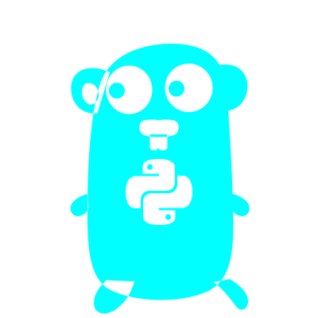

# GoPython 

GoPython is a small Python-inspired interpreter and runner written in Go. It is a work in progress and is currently in **beta**.

> **⚠️ Warning:** GoPython is still in beta.

## Features

- Assign string and numeric values to variables.
- Define functions with positional parameters.
- Return values from functions.
- Call built-in `print()` and `abs()`.
- Call user-defined functions, including nested calls.
- Ignore blank lines and comments beginning with `#`.

## Getting started

The Go module is located in `src/` and targets Go 1.22.

To run the example program:

```sh
cd src
go run example.go GoPython.go
```

The example defines a `magnitude(value)` function and prints the absolute value of `-42`.

## Example

```python
def magnitude(value):
    return abs(value)

print(magnitude(-42))
```

## Documentation

See **[docs.md](docs.md)** for the language syntax, built-in functions, Go API usage, limitations, and contribution notes.

## License

This project is distributed under the MIT License. See [LICENSE](LICENSE).
